# Plugin MySkoda

Suivi et pilotage d'un véhicule Škoda par l'API publique officielle MyŠkoda.

> Documentation du plugin en version 0.9 beta, publiée le 10/10/2026. Elle décrit ce que permet l'API publique de Škoda à cette date (version 1.1.0). Škoda peut faire évoluer son API : ce qui est écrit ici, en particulier le quota de requêtes et la liste des commandes possibles, vaut pour cette version. Documentation de l'API chez Škoda (en anglais) : [public.api.connect.skoda-auto.cz/docs](https://public.api.connect.skoda-auto.cz/docs), avec son [journal des évolutions](https://public.api.connect.skoda-auto.cz/docs/changelog) et sa [référence technique détaillée](https://public.api.connect.skoda-auto.cz/docs/swagger-ui/index.html), qui liste chaque demande que le plugin peut adresser à Škoda.

Prérequis : Jeedom 4.4 ou plus récent (le plugin est testé sur Jeedom 4.6), sous Debian 12 ou Debian 13. Debian 11, qui n'est plus maintenue, n'est pas prise en charge. Le plugin n'a ni démon ni dépendance.

## Mise en service

### 1. Créer une clé dans l'application MyŠkoda

Sur le téléphone, dans l'application MyŠkoda : Profil, puis Maison intelligente. Créez une clé et copiez-la.

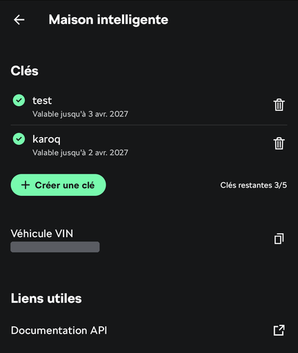

Cet écran liste vos clés (cinq au plus), permet d'en créer une et affiche le numéro de série du véhicule (VIN), à copier pour l'étape 3. Une clé vaut pour les véhicules choisis à sa création, et elle expire : sa date de fin est indiquée sous son nom.

### 2. Saisir la clé dans Jeedom

Dans la configuration du plugin, collez la clé. Les deux rythmes de lecture (à l'arrêt et en charge, et en déplacement) peuvent rester tels quels.

### 3. Ajouter le véhicule

Dans le plugin, cliquez sur « Ajouter un véhicule » et saisissez son numéro de série (17 caractères). Le plugin vérifie auprès de Škoda que la clé couvre ce véhicule, puis crée l'équipement, nommé d'après la désignation que Škoda donne au véhicule, dans la catégorie Énergie. Cet ajout coûte deux requêtes sur le quota de l'heure : la vérification, puis la première lecture. Il reste à lui choisir un objet parent.

Škoda ne permet pas à un plugin de lister les véhicules d'un compte : c'est pourquoi le numéro de série est demandé, une fois par véhicule.

Les commandes sont créées à la première lecture, faite dès l'ajout du véhicule : seules celles que le véhicule fournit sont créées. Certaines sont créées masquées (câble verrouillé, coffre, capot, feux, mode de charge, expiration de la clé…) : elles se rendent visibles par leur case « Afficher ».

> **À LIRE : le journal de bord démarre vide.**
> **Škoda ne fournit aucun historique aux plugins. Les trajets, les recharges, les pleins et les statistiques sont reconstitués par le plugin à partir de ce qu'il relève lui-même, à compter de son installation. Juste après l'installation, ces onglets sont donc vides : ils se remplissent au fil des trajets. L'historique affiché par l'application MyŠkoda n'est pas repris.**

## Informations

Batterie, autonomie, état et puissance de charge, temps restant, câble branché et verrouillé, limite et mode de charge, climatisation et température de consigne, verrouillage, portes, vitres, coffre, capot, feux, kilométrage, déplacement, position et adresse de stationnement ; carburant et autonomie pour les véhicules thermiques et hybrides.

## Commandes

Rafraîchir, démarrer et arrêter la charge, régler la limite de charge, choisir le mode de charge, démarrer la climatisation (avec ou sans température) et l'arrêter, régler la consigne de climatisation, démarrer et arrêter la ventilation, démarrer et arrêter le chauffage auxiliaire.

Une commande est transmise au véhicule ; son effet se lit à la relecture suivante, une minute plus tard. Ce délai se règle dans la configuration du plugin (« Relecture après une commande », de 20 secondes à 2 minutes) : plus court, l'état suit plus vite dans un scénario ; trop court, la voiture n'a pas encore répondu et l'état ne changera qu'à la lecture d'après.

**Chauffer la voiture avant de partir.** Sur un véhicule électrique, c'est la commande « Démarrer la climatisation » (ou « Démarrer la climatisation à », avec une température) : elle chauffe ou rafraîchit l'habitacle selon la consigne, et ne demande aucun code. Elle s'utilise dans un scénario, par exemple le matin si la température extérieure est basse. 

**Préchauffage voiture non branchée : c'est vous qui décidez.** Par défaut, le plugin ne demande rien de particulier : si la voiture n'est pas branchée, c'est son propre réglage (dans la voiture ou dans l'application MyŠkoda) qui décide si elle chauffe sur sa batterie ou si elle refuse. Quand le véhicule communique ce réglage, la commande info « Climatisation sans branchement autorisée » le montre ; tous ne le font pas (un Elroq, par exemple, ne le transmet pas). Pour que le plugin demande lui-même le chauffage sur batterie, cochez sur la page de l'équipement la case « Autoriser la climatisation sur la batterie, voiture non branchée ». Elle est décochée par défaut, pour qu'un scénario ne consomme jamais votre autonomie sans que vous l'ayez voulu : chauffer sur la batterie réduit l'autonomie disponible au départ.

**Chauffage auxiliaire et code S-PIN.** Certains véhicules thermiques et hybrides ont un chauffage auxiliaire (chauffage stationnaire). Škoda exige le code S-PIN pour le démarrer. Ce code est propre à chaque véhicule et à son utilisateur principal : saisissez-le sur la page de l'équipement du véhicule, champ « Code S-PIN de ce véhicule ». Il est enregistré chiffré dans Jeedom et n'est jamais écrit dans les logs. Les commandes « Démarrer le chauffage auxiliaire » et « Arrêter le chauffage auxiliaire » n'apparaissent que si le véhicule en est équipé ; la durée de chauffe est celle réglée sur le véhicule. C'est la seule commande qui demande ce code.

## Tuile

La tuile montre l'image du véhicule fournie par Škoda, les états (verrouillage, portes, vitres, câble), la batterie et l'autonomie, la charge et la climatisation avec leurs boutons, l'adresse de stationnement.

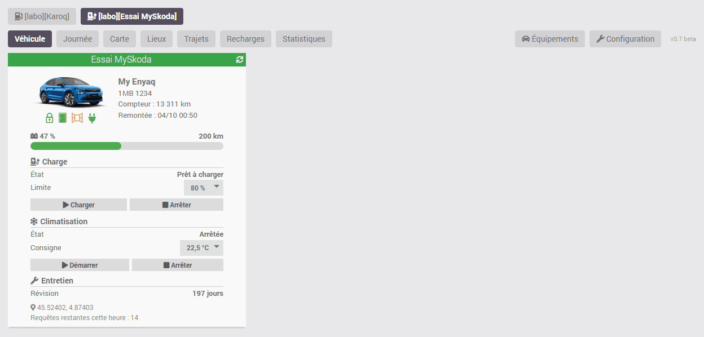

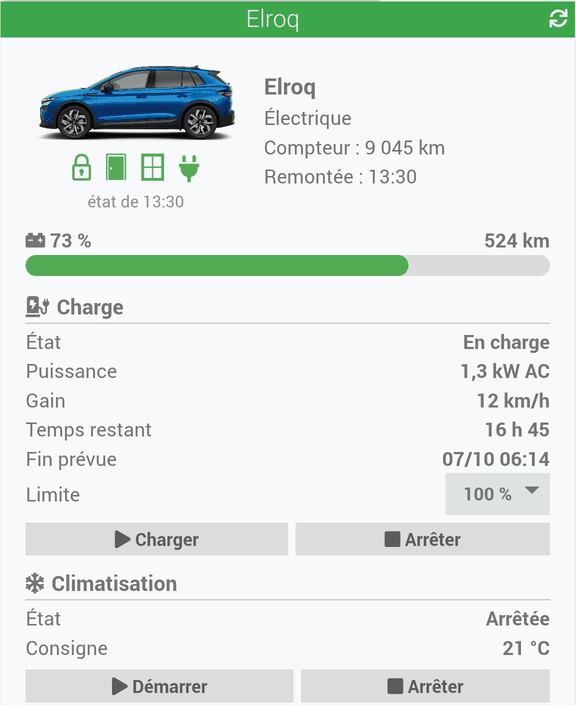

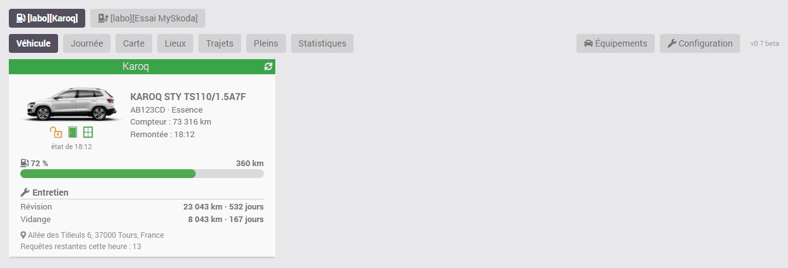

Sur ces captures, les adresses, la plaque et les lieux sont des exemples.

- Chaque élément suit la case « Afficher » de sa commande : la décocher le retire de la tuile.
- Un thermique affiche une jauge de carburant à la place de la batterie.
- L'heure de l'état du verrouillage et des ouvrants est toujours indiquée sous les icônes ; si cet état a plus de 24 heures de retard sur le reste, les icônes sont estompées.
- Les détails de la charge (puissance, gain, temps restant, fin prévue) n'apparaissent que pendant une charge.
- La limite de charge se règle directement dans la liste de la tuile.
- Profils de charge (électriques et hybrides rechargeables) : si vous avez défini des lieux de recharge dans l'application MyŠkoda, la tuile indique, dans un bloc « Profils de charge », le « Profil du lieu » où la voiture est garée et, quand Škoda la donne, sa prochaine charge. Le bandeau « Voir tous les profils », à déplier d'un clic, liste chaque profil : limite de charge, charge minimale (en dessous, la voiture charge tout de suite), plages de charge et minuteries actives. C'est une lecture : les profils se modifient dans l'application MyŠkoda. Pour les retirer de la tuile, décochez « Afficher » sur la commande « Profil de charge du lieu ». Quatre commandes d'information servent aux scénarios : « Profil de charge du lieu » (vide quand la voiture n'est dans aucun lieu enregistré), « Profil de charge : limite », « Profil de charge : charge minimale » et « Profil de charge : prochaine charge ».
- La consigne de climatisation se règle de la même façon, dans la liste « Consigne ». Škoda ne permet pas de changer la température seule : elle n'est transmise qu'au démarrage. La valeur choisie est donc gardée par le plugin et envoyée quand vous appuyez sur « Démarrer » ; si la climatisation tourne déjà, elle est relancée à la nouvelle température. Tant que vous n'avez rien choisi, la liste montre la consigne de la voiture. Une fois choisie, la consigne (de 16 à 30 °C, par demi-degré) est envoyée à chaque démarrage de la climatisation, y compris depuis un scénario. Dans un scénario, la commande « Régler la consigne de climatisation » fait la même chose, et « Démarrer la climatisation à » démarre directement à une température donnée.
- Puissance de charge : la tuile affiche la valeur transmise par la voiture, au dixième de kW ; l'application MyŠkoda l'arrondit au kW entier, d'où un léger écart possible.
- Présentation « Carte » : sur la page de l'équipement, « Présentation de la tuile » propose « Tuile (par défaut) » ou « Carte ». La carte a une largeur fixe (330 pixels, hauteur selon le contenu, 500 au moins) et un fond de couleur, pensée pour un design ; elle remplace le cadre et le bandeau de titre de Jeedom. Elle porte tout ce que porte la tuile, présenté autrement : l'état du véhicule dans une pastille, la batterie ou le carburant en grands chiffres avec un repère à la limite de charge, un grand bouton rond pour la charge, la climatisation et le chauffage auxiliaire (démarrer ou arrêter selon l'état, la commande inverse restant à côté en petit), les profils de charge, l'entretien, le lieu et le quota. Sur la carte, toute commande envoyée à la voiture demande une confirmation : charge, climatisation, chauffage auxiliaire, limite de charge. « Couleur de fond de la carte », sur la même page, choisit la couleur : le fond en est un dégradé, et les textes passent au sombre sur une couleur claire. Si vous avez choisi une couleur claire, la carte prend la version sombre de cette couleur quand Jeedom passe à son thème sombre (le soir, si l'option est activée dans les réglages de Jeedom) ; une carte sombre reste la même le jour et le soir. Comme sur la tuile, décocher « Afficher » sur une commande la retire de la carte.

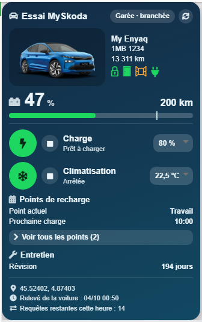

- Pour revenir à l'affichage standard de Jeedom : configuration avancée de l'équipement, onglet Informations, option « Template de widget ».

## Journal de bord (panneau)

**Le journal démarre vide à l'installation du plugin et se construit au fil des trajets : Škoda ne fournit aucun historique.**

Activez « Afficher le panneau desktop » dans la configuration du plugin : une entrée MySkoda apparaît dans le menu Accueil. « Afficher le panneau mobile » fait de même dans l'application mobile et la version mobile de Jeedom. Le journal est le même sur les deux. La version mobile de Jeedom n'a pas de page de réglage : l'ajout d'un véhicule et la configuration du plugin se font dans la version ordinateur, vers laquelle deux boutons, « Véhicules » et « Configuration », renvoient en bas du journal mobile, pour les administrateurs.

Avec plusieurs véhicules, une rangée de boutons en haut du journal choisit celui que l'on regarde : tous les onglets portent sur ce véhicule. Le journal s'adapte à son énergie : batterie, kWh et recharges pour un électrique ; carburant, litres et pleins pour un thermique. Pour un hybride rechargeable, deux boutons, « Vue électrique » et « Vue carburant », choisissent l'énergie regardée.

- **Véhicule** : la tuile de la voiture choisie, avec ses boutons, comme sur le dashboard.
- En haut à droite, pour les administrateurs : raccourcis vers les équipements et vers la configuration du plugin.
- **Journée** : état actuel du véhicule (stationné, en déplacement ou en charge, depuis quand et où), résumé du jour (temps à l'arrêt ; trajets : durée, distance, vitesse moyenne, consommation ; recharges : durée, autonomie et énergie gagnées, coût), courbe de la batterie et frise de 0 h à 24 h, puis une carte par trajet et par recharge avec les lieux. Les flèches passent d'un jour à l'autre.
- **Carte** : lieux de stationnement connus, position actuelle, trajets et recharges du jour choisi. Si la voiture n'a pas roulé aujourd'hui, la carte s'ouvre sur le dernier jour où elle a roulé. Les lieux se gèrent dans l'onglet « Lieux ». Le fond de carte vient d'OpenStreetMap : pour l'afficher, votre navigateur interroge les serveurs d'OpenStreetMap, qui voient donc la zone regardée. Rien d'autre n'est transmis, et aucune donnée du véhicule ne leur est envoyée par le plugin.
- **Trajets** : tableau sur une période, avec lieux de départ et d'arrivée.
- **Recharges** (électrique) : tableau sur une période, avec totaux par mois, puissance moyenne, prix et coût.
- **Pleins** (thermique) : un plein est reconnu quand le niveau de carburant remonte d'au moins 5 points entre deux lectures ; tableau avec lieu, quantité, prix et coût.
- **Statistiques** : sur une période (7 jours, 30 jours, 12 mois, « Cette année » ou dates libres), les chiffres clés (distance, trajets, vitesse et consommation moyennes, énergie consommée et rechargée, coûts), cinq histogrammes par jour ou par mois (distance, consommation, énergie rechargée, temps de conduite, vitesse moyenne) et un tableau par mois.

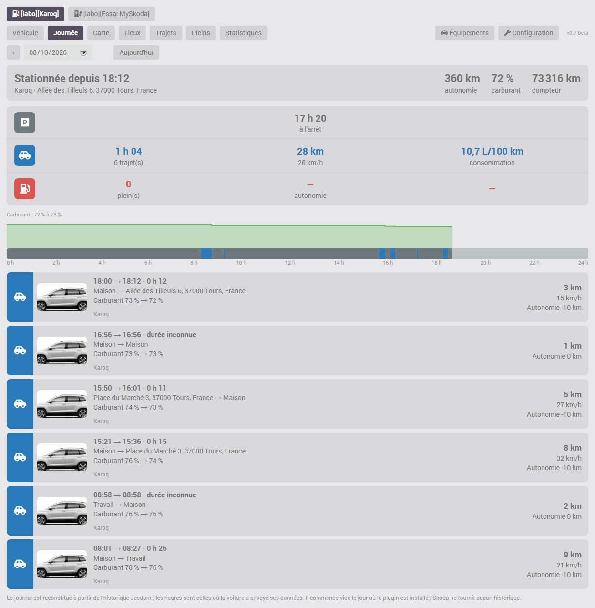

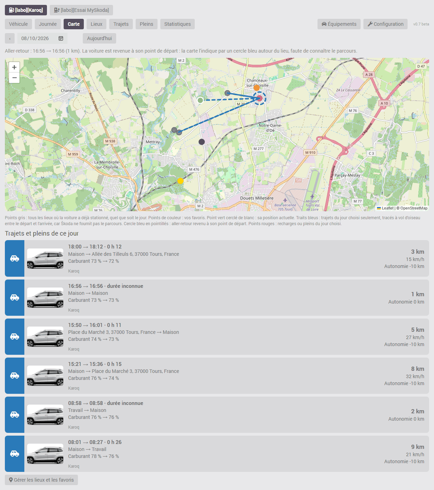

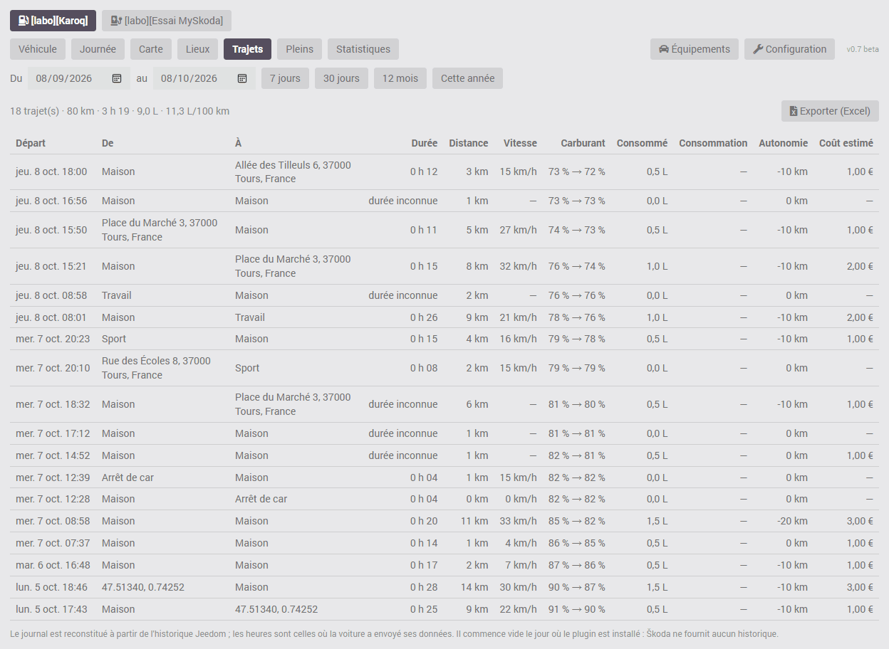

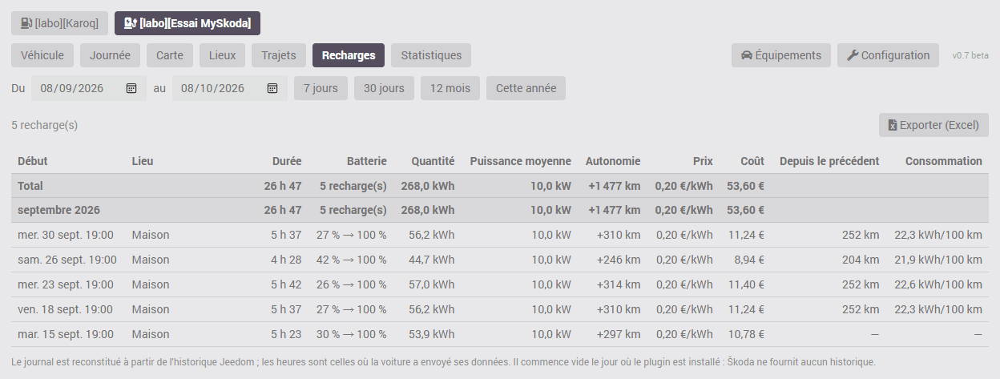

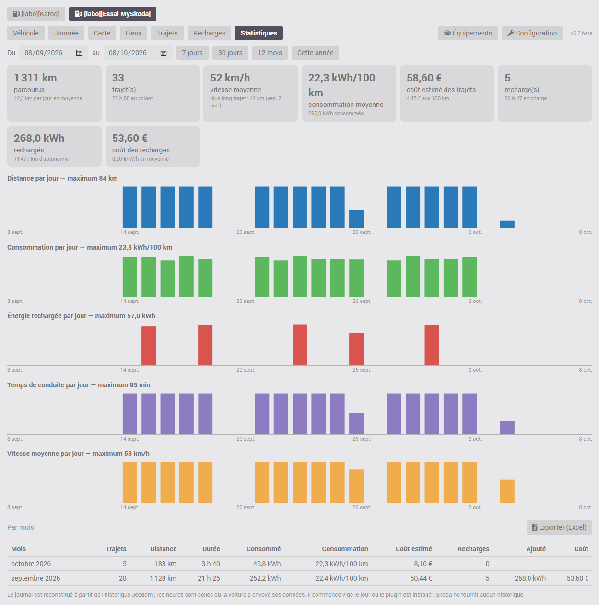

Les onglets Trajets, Recharges et Statistiques ont un bouton **Exporter (Excel)** : il produit un fichier CSV que Excel et LibreOffice ouvrent directement, avec une ligne par trajet, par recharge ou par mois.

Trajets et recharges sont reconstitués à partir de l'historique Jeedom des commandes « En déplacement » et « En charge ». La voiture envoie ses données à Škoda au départ et à l'arrivée ; le plugin date chaque valeur de l'heure de cet envoi, si bien que les heures des trajets sont exactes quel que soit le rythme de lecture. Un trajet fait en entier entre deux lectures est reconnu à l'avancée du compteur : sa distance est juste, sa durée est indiquée comme inconnue.

**Arrêts courts.** Škoda ne donne que le dernier état connu du véhicule, sans historique. Un arrêt de quelques minutes (déposer quelqu'un, retirer un colis) qui commence et se termine entre deux lectures du plugin n'est donc pas vu : plusieurs petits trajets enchaînés apparaissent comme un seul, dont la distance et les heures de départ et d'arrivée restent justes. En déplacement, le plugin lit toutes les 5 minutes par défaut, et garde ce rythme 10 minutes après l'arrêt et après le début ou la fin d'une recharge ; ce rythme se règle dans la configuration du plugin, dans la limite des 20 requêtes par heure imposée par Škoda. **Ne décochez pas la case « Historiser » des commandes du plugin, et ne modifiez pas leur mode d'historisation** : le journal de bord est entièrement tiré de l'historique Jeedom. Sans lui, il reste vide, et ce qui n'a pas été historisé ne peut pas être reconstitué après coup. Les commandes nécessaires sont : En déplacement, Kilométrage, Latitude, Longitude, Batterie et Autonomie électrique (ou Carburant et Autonomie carburant), En charge et Puissance de charge, ainsi que Câble branché si l'option « Recharge pilotée » est cochée. Si l'une d'elles n'est plus historisée, le journal l'indique en haut de page. Le volume est faible : une valeur n'est enregistrée que lorsque la voiture envoie un nouveau relevé.

Les lieux sont les adresses de stationnement données par Škoda, que le plugin mémorise au fil des arrêts. Škoda ne donne aucune position pendant qu'un véhicule roule : sur la carte, un trajet est un trait droit entre son départ et son arrivée, pas son parcours. Pour la même raison, un aller-retour sans arrêt (la voiture revient se garer là d'où elle est partie) n'a pas de trait : il est signalé par un cercle bleu en pointillés autour du lieu, et sa distance est celle du compteur.

Deux stationnements à moins de 60 mètres l'un de l'autre sont le même lieu. La position transmise par la voiture n'est pas toujours exacte : il arrive qu'elle s'écarte de plus de cent mètres alors que la voiture est garée au même endroit, ce qui crée un second lieu.

**Onglet « Lieux » : vos lieux favoris.** Cet onglet du journal de bord rassemble tout ce qui concerne les lieux : leur carte, l'ajout d'un favori et la liste des lieux connus. Un favori (Maison, Travail, École…) rattache à lui tout stationnement fait dans son rayon, et son adresse ne change plus. Seuls les administrateurs de Jeedom peuvent modifier les lieux ; les autres utilisateurs voient la liste sans pouvoir la changer.

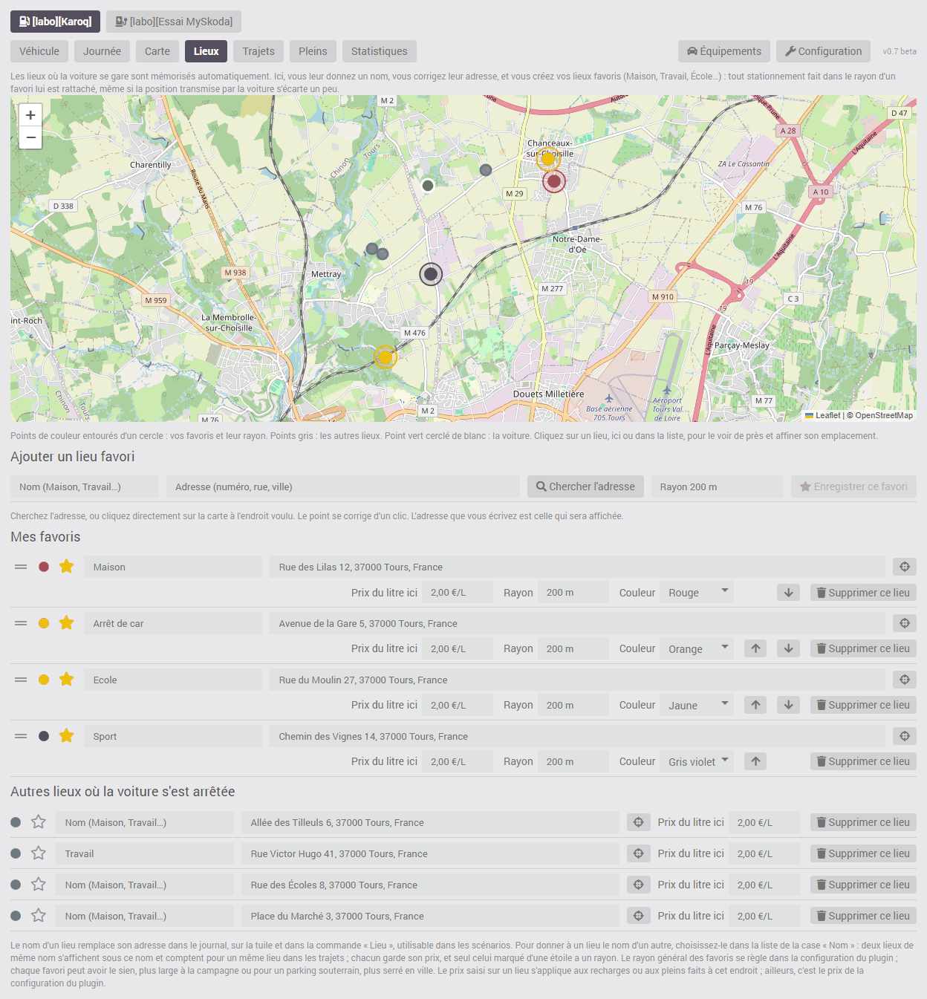

Pour ajouter un favori, donnez-lui un nom, puis placez son point de l'une de ces façons : écrivez son adresse et cliquez sur « Chercher l'adresse », ou cliquez directement sur la carte à l'endroit voulu (un nouveau clic corrige le point), et terminez par « Enregistrer ce favori ». L'adresse que vous écrivez est celle qui sera affichée : c'est le moyen d'avoir la bonne adresse quand celle que Škoda donne pour votre domicile est fausse. La recherche d'adresse est faite par votre Jeedom auprès du service d'OpenStreetMap, uniquement quand vous cliquez sur le bouton ; le clic sur la carte n'envoie rien.

Pour revoir un lieu déjà enregistré, cliquez sur son point sur la carte ou sur le bouton en forme de cible de sa ligne, après l'adresse : la carte s'en approche et montre son emplacement en rouge. Un clic sur la carte le déplace ; « Valider ce point et vérifier son adresse » valide, « Annuler » laisse le lieu tel quel. À la validation, que le point ait bougé ou non, votre Jeedom demande au service d'OpenStreetMap l'adresse de ce point et vous la propose si elle diffère de l'adresse affichée : vous enregistrez avec cette adresse, ou vous gardez l'adresse actuelle. C'est le moyen de corriger un lieu bien placé dont l'adresse est fausse. Si l'adresse n'est pas trouvée, seule la position est enregistrée.

Un lieu ordinaire qui se trouve dans le rayon d'un favori ne sert plus : les stationnements faits à cet endroit sont rattachés au favori. Si vous ne lui avez donné ni nom, ni prix, ni adresse, il est retiré de la liste. Sinon il est gardé avec la mention « couvert par le favori », et c'est à vous de le supprimer ou de réduire le rayon du favori.

La liste est en deux parties. « Mes favoris » vient en premier : vous les rangez dans l'ordre que vous voulez en les glissant par la poignée à traits horizontaux, au début de la ligne, ou avec les flèches placées dans les réglages de la ligne, et chaque favori a sa couleur, choisie dans une liste et reprise sur les cartes du journal (Maison en vert, École en rouge…). « Autres lieux où la voiture s'est arrêtée » vient ensuite, les plus récents en tête ; au-delà de six, les plus anciens sont repliés derrière un bouton.

Chaque ligne montre l'essentiel : la couleur, l'étoile, le nom, l'adresse et la cible qui ouvre le lieu sur la carte. Les réglages plus rares suivent : le prix du kWh ou du litre à cet endroit, le rayon et la couleur d'un favori, la suppression. Sur un écran d'ordinateur ils sont toujours visibles, à la suite sur la ligne ; sur un téléphone, ils se déplient par la flèche en bout de ligne.

Un lieu déjà connu devient favori en lui donnant un nom et en cliquant sur son étoile, qui passe au jaune ; un second clic le retire des favoris. Son adresse se corrige dans la liste ; une adresse corrigée n'est plus remplacée par celle de Škoda. Le rayon général des favoris se règle dans la configuration du plugin (200 mètres par défaut) ; chaque favori peut avoir le sien (de 10 à 5 000 mètres), plus large à la campagne ou pour un parking souterrain où la position est imprécise, plus serré en ville. Si Jeedom connaît les coordonnées de votre domicile (configuration générale de Jeedom), un bouton propose de créer le favori « Maison » à cet endroit, sans rien saisir.

La case « Nom » propose la liste des noms déjà donnés : pour donner à un autre lieu le nom d'un lieu existant, choisissez-le dans cette liste plutôt que de le retaper. Deux lieux portant le même nom s'affichent sous ce nom et comptent pour un même lieu dans les trajets ; chacun garde son propre prix, et seul celui marqué d'une étoile a un rayon. Le bouton « Supprimer ce lieu » (corbeille), dans les réglages de la ligne, retire un lieu créé par erreur ; les trajets déjà enregistrés ne sont pas modifiés. Le plugin garde 300 lieux par véhicule ; supprimer un équipement efface ses lieux.

Le nom donné à un lieu remplace son adresse dans le journal et sur la tuile. La commande « Lieu » le porte aussi : elle sert de déclencheur ou de condition dans un scénario (par exemple « Lieu » égal à « Maison »).

**Recharge pilotée par un scénario (surplus solaire, batterie domestique, heures creuses).** Par défaut, le journal compte une recharge à chaque fois que la voiture se met à charger. Si un scénario démarre et arrête la charge au fil de la journée, par exemple pour suivre la production de panneaux solaires, cela donne une multitude de petites recharges, dont l'énergie ne peut pas être calculée. Dans ce cas, cochez la case du champ « Recharge pilotée » (« Charge pilotée par un scénario ») sur la page de l'équipement du véhicule concerné : le journal compte alors **une seule recharge par branchement du câble**, toutes reprises comprises. Il affiche la durée de charge réelle, le nombre de reprises et le temps pendant lequel le câble est resté branché ; l'énergie, la puissance moyenne et le coût sont calculés sur l'ensemble. Pour une recharge ordinaire, d'un seul tenant, l'option ne change rien. Elle s'applique aussi aux recharges déjà enregistrées, à condition que la commande « Câble branché » ait été historisée ces jours-là : une recharge faite sans cet historique reste comptée reprise par reprise. Elle se décoche sans rien perdre. Pour ces scénarios, voyez aussi le réglage « Relecture après une commande » de la configuration du plugin.

**Consommation.** Škoda ne donne le niveau de batterie ou de carburant qu'en pourcentage entier. Une consommation n'est donc affichée que si le niveau a baissé d'au moins 5 points : pour un trajet isolé, cela demande un trajet assez long ; pour une journée, un mois ou une période, le calcul porte sur le total (ce qui a été consommé, divisé par la distance), ce qui le rend fiable. Dans l'onglet Recharges ou Pleins, chaque ligne donne aussi la distance parcourue et la consommation depuis la recharge ou le plein précédent : c'est le chiffre le plus juste.

Des valeurs que Škoda ne fournit pas sont à saisir pour obtenir tous les chiffres : sur l'équipement, la **capacité utile de la batterie** (pour les kWh) ou la **contenance du réservoir** (pour les litres) ; et le **prix du kWh** ou **du litre de carburant** (pour les coûts). Le prix se saisit à deux endroits : un prix général dans la configuration du plugin, et, dans l'onglet « Lieux », un prix propre à un lieu (votre domicile, une borne publique), au réglage « Prix du kWh ici » ou « Prix du litre ici » de sa ligne. Pour le carburant, un prix du litre peut aussi être saisi sur l'équipement d'un véhicule : il remplace alors le prix général pour ce véhicule. Une recharge est comptée au prix du lieu où elle a été faite, à défaut au prix général ; le coût d'un trajet est estimé au prix général.

## Entretien

Škoda ne transmet aux plugins ni les échéances de révision et de vidange, ni le rapport d'état du véhicule. Le plugin propose donc un suivi à saisir à la main, dans la page de l'équipement : révision, vidange et contrôle technique.

Pour la révision et la vidange, indiquez l'échéance (kilométrage au compteur et date) ; pour le contrôle technique, la date seule. Vous pouvez aussi recopier ce qu'affiche l'application MyŠkoda (Inspecter, Service) sous la forme « dans tant de km » et « dans tant de jours » : le plugin convertit à l'enregistrement. Il décompte ensuite les kilomètres et les jours restants (commandes « Révision : kilomètres restants », etc., utilisables dans les scénarios), les affiche sur la tuile, et prévient dans le centre de messages quand une échéance passe sous le seuil d'alerte (1 000 km ou 30 jours par défaut, réglables). Après un entretien, saisissez la nouvelle échéance.

## Données désactivées sur le véhicule

Škoda peut répondre qu'une partie des données (verrouillage et ouvrants, carburant, kilométrage, position…) existe sur le véhicule mais est désactivée. Le plugin l'affiche sur la tuile, dans la commande « Services désactivés » et dans le centre de messages. Cela ne se règle pas dans Jeedom : il faut vérifier dans l'application MyŠkoda que les services en ligne du véhicule sont actifs (licence en cours de validité), que le consentement au partage des données est donné, et que le véhicule n'est pas en mode privé.

## Signaler un problème

Joignez d'abord le **rapport de diagnostic** : dans la configuration du plugin, rubrique « Diagnostic et support », le bouton « Générer un rapport de diagnostic » affiche un texte que vous copiez ou téléchargez avec les deux boutons placés dessous. Il donne la version du plugin, de Jeedom, de PHP et de Debian, les réglages, et pour chaque véhicule son modèle, ses options, ses commandes, l'heure des dernières lectures, le quota restant, les valeurs principales, le nombre de trajets et de recharges des sept derniers jours, puis les messages et les dernières lignes d'erreur du plugin. Il ne contient ni clé, ni code S-PIN, ni numéro de série, ni plaque, ni nom d'équipement, ni lieu, ni adresse, ni position : les véhicules y sont numérotés, et il peut être transmis tel quel.

Si on vous le demande ensuite, joignez aussi le log `myskoda` au niveau Debug (configuration du plugin, cadre « Logs et surveillance », puis menu Analyse → Logs). Ce log contient les réponses de Škoda, dont le plugin retire le numéro de série, la plaque, l'adresse et les coordonnées de stationnement avant de les écrire. La clé API et le code S-PIN n'y figurent jamais. Le nom que vous avez donné à l'équipement, lui, y apparaît.

## Données momentanément indisponibles chez Škoda

Il arrive que Škoda réponde sans aucune donnée du véhicule, chaque rubrique étant « indisponible » : cela s'observe notamment pendant qu'un véhicule roule. Le plugin garde alors les dernières valeurs reçues et l'indique sur la tuile et en haut du journal de bord, avec l'heure depuis laquelle cela dure (commande « Données Škoda indisponibles depuis »). Rien n'est à faire : un trajet ou une recharge en cours se termine à la bonne heure dès que Škoda répond de nouveau, parce que la voiture date elle-même ses relevés.

## Limites

- Škoda autorise 20 requêtes par heure et par véhicule, lectures et commandes comprises. Le plugin lit toutes les 10 minutes à l'arrêt et pendant une recharge (6 requêtes par heure), et toutes les 5 minutes en déplacement (12 par heure). **Une commande transmise au véhicule coûte deux requêtes** : la commande, puis la relecture qui suit une minute après pour en voir l'effet. La commande « Rafraîchir » en coûte une. Régler la consigne de climatisation n'en coûte aucune tant que la climatisation est arrêtée. À l'arrêt ou en charge, il reste donc de quoi envoyer six ou sept commandes par heure ; au-delà, Škoda refuse jusqu'à l'heure suivante. Dans un scénario, évitez d'appeler « Rafraîchir » ou une commande en boucle : les valeurs se mettent déjà à jour toutes seules. Le plugin garde toujours les trois dernières requêtes de l'heure pour les commandes : quand il n'en reste que trois, les lectures automatiques s'arrêtent jusqu'au renouvellement du quota, et la tuile ne change plus pendant ce temps ; « Requêtes restantes » et « Expiration de la clé » permettent de suivre le quota et la validité de la clé.
- L'API ne réveille pas le véhicule : les valeurs sont celles de sa dernière remontée (commande « Dernière remontée du véhicule »).
- La clé expire. Le plugin ne prévient pas à l'avance : il le signale dans le centre de messages de Jeedom quand Škoda refuse la clé, puis attend une heure avant de réessayer, ou reprend dès qu'une nouvelle clé est enregistrée. La date de fin est dans la commande « Expiration de la clé » (masquée par défaut), qu'un scénario peut surveiller.
- Si Škoda ajoute une commande à son API et qu'un véhicule l'annonce, le plugin le signale une fois dans le centre de messages.
- Non proposés par l'API : verrouillage à distance, klaxon et appel de phares, état porte par porte.
